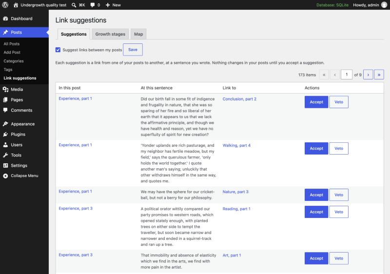
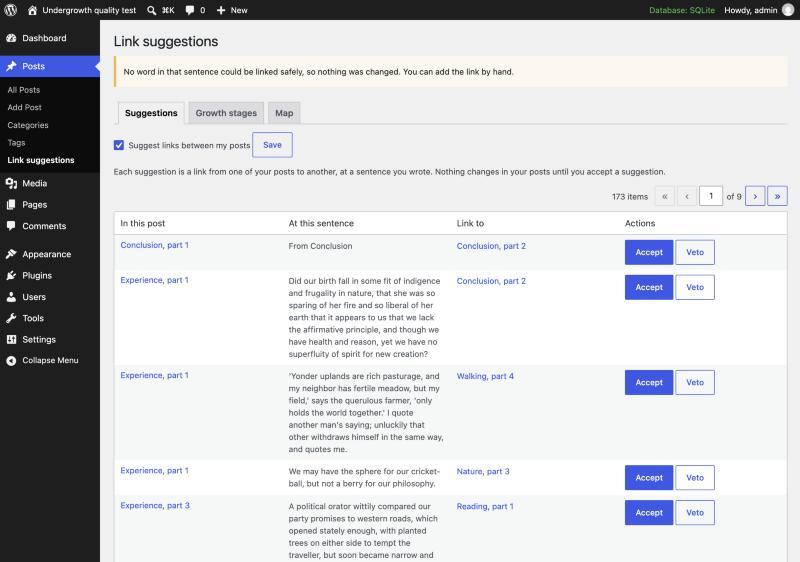
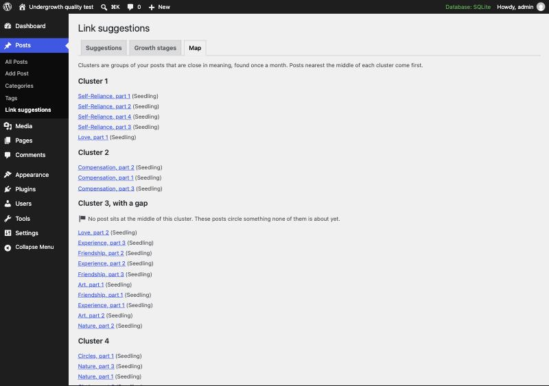

# Suggestion quality report, v1

This is the first test of Undergrowth's link suggestions, clusters and growth stages with real embeddings on a realistic corpus, rather than the word-counting e2e provider on a few fixture posts. It used no API key. The posts were embedded by a free local model through `docs/examples/local-embeddings.php`.

Tested on 21–22 October 2026, against `main` at 3745b84 (and e273379 for the first run), plus the fixes listed under each finding.

## Summary

- **Link targets are mostly sensible.** In a random sample of 40 proposals, 36 pointed somewhere a reader of the source post could reasonably want to go. Almost every post's nearest neighbour was another part of the same essay (54 of 61). Cross-essay links followed the corpus's real themes: ponds and spring, fishing and hunting, friendship and love, economy and the simple life.
- **Sentences are reasonable; anchor words are the weak point.** The chosen sentence usually holds the shared subject. But in 12 of the 40 sampled proposals the linked word was incidental (*trying*, *moved*, *vicinity*), and in 4 there was no word to link at all.
- **Some proposals could never be accepted:**
  - 8% picked a heading sentence (#168).
  - 8% picked a sentence chosen before the whole site was indexed (#169, fixed in #177).
  - Every proposal in a Classic-editor post failed: 60 of 60 (#170, fixed in #171).
- **Quotes are respected.** None of the 170–180 proposals per run, nor any accepted link, landed inside the 44 quoted verses and epigraphs.
- **Thresholds are model-specific.** With nomic-embed-text, the defaults tuned for OpenAI proposed links between everything and put all 60 posts in one cluster. Tuned values (now in the example) gave 8 clusters that make sense (#176).
- **Stages follow the handover rules exactly:** 0 mismatches in 61 posts.
- **Time and memory:**
  - Germinating 60 posts took 37 s, with peak memory under 50 MB.
  - Each backfill request slows as the site grows: 7 s per batch at 20 posts, 25 s at 300 (#174).

## Method

### Corpus

There are 60 posts, about 73,000 words in all (900–1,600 words each, mean 1,214). They were split in reading order from four public-domain texts on Project Gutenberg:

| Source | Gutenberg # | Essays or chapters used | Posts |
|---|---|---|---|
| Ralph Waldo Emerson, *Essays: First Series* (1841) | 2944 | Self-Reliance, Compensation, Love, Friendship, Prudence, Heroism, Circles, Art | 20 |
| Ralph Waldo Emerson, *Essays: Second Series* (1844) | 2945 | Experience, Gifts, Nature, Manners | 9 |
| Henry David Thoreau, *Walden* (1854) | 205 | Economy, Where I Lived, and What I Lived For, Reading, Sounds, Solitude, Visitors, The Bean-Field, The Ponds, Higher Laws, Brute Neighbors, Winter Animals, Spring, Conclusion (13 of its 18 chapters) | 27 |
| Henry David Thoreau, *Walking* (1862) | 1022 | the whole essay | 4 |

The texts overlap on nature, solitude, friendship, work and self-reliance, so there are real cross-links to find and real near-misses to avoid. No text was written for the test. The posts are the authors' own words with these additions:

- Each post is titled after its essay, for example "Compensation, part 2". It opens with a short heading, "From Compensation", and ends with a source credit paragraph.
- Verse and epigraphs (44 in 23 posts) are Quote blocks with a `<cite>` where the source names one.

The tested corpus came from `docs/quality-report-v1/build_corpus.py` as first committed (7dc2d03). It had two flaws, found in review after the runs and fixed in the builder since. "Economy, part 1" opened with *Walden*'s table of contents as a Quote block (one of the 44). Each *Walden* chapter's first post opened with the chapter title as a one-word paragraph. Neither text was ever chosen for a link. Both slightly blur the embeddings of 13 posts. The committed builder gives 42 quote blocks, and the runs were not repeated with it.
- Where a text has no paragraph breaks (*Walking*), paragraphs were cut at sentence ends every 200 words or so.

The corpus builder is `docs/quality-report-v1/build_corpus.py`. Posts are block markup. A second copy converted to Classic-editor markup (paragraphs separated by blank lines, no `<p>` tags) tested #170. WordPress's own "Hello world!" post stayed published, as on a fresh site.

### Site and model

- WordPress 7.1.3 on PHP 8.2, SQLite through the SQLite Database Integration drop-in, single site. Cron was run from the command line with `DISABLE_WP_CRON`. A small driver ran every due event as `wp-cron.php` does and logged each event's time and peak memory.
- Ollama 0.40.7 (Homebrew) bound to 127.0.0.1, serving **nomic-embed-text** (768 dimensions, 2,048-token window).
- `docs/examples/local-embeddings.php` installed as a mu-plugin. It cuts each post to 8,000 bytes (about 1,800 tokens) before sending.
- A harness mu-plugin blocked every request to a host other than localhost. Nothing left the machine. WordPress.org update checks and pings were refused.
- Posts were published first, then Undergrowth was activated, as on an existing blog. This exercises the backfill (#113).

### Runs

| Run | Thresholds (link / cluster / gap) | What it shows |
|---|---|---|
| default | 0.4 / 0.5 / 0.8 (OpenAI defaults) | What a site gets with this model and no tuning |
| tuned | 0.7 / 0.8 / 0.8, then 0.94 gap | The thresholds now in the example |
| tuned, refreshed | as tuned, after refreshing every post's proposals | Proposals once the whole site is indexed |
| Classic | tuned, Classic-editor markup, on `main` and on #171 | Accepting links in Classic posts |
| 300 posts | tuned, the corpus five times over | How time grows with the site (the copies make it unfit for judging quality) |

For stages, each post's top proposal was accepted as an author would accept it (`undergrowth_accept_link()` as an administrator). Then the monthly cluster cycle was run, which chains the stage cycle.

Timings come from an otherwise idle machine with Xdebug off. One rerun shared the machine with other heavy jobs (load average above 250) and took 1,358 s instead of 37 s. Treat timings as relative.

## Embedding scores

nomic-embed-text scores every pair of posts by one author high:

| | min | p10 | p25 | median | p75 | p90 | p99 | max |
|---|---|---|---|---|---|---|---|---|
| cosine, 1,830 pairs | 0.38 | 0.63 | 0.68 | 0.72 | 0.75 | 0.78 | 0.90 | 0.94 |

"Hello world!" scores 0.38–0.52 against everything. Parts of one essay score 0.82–0.94 with each other (median 0.90). Posts from different essays score 0.52–0.90, with a median of 0.72 and 90% below 0.78. The closely related pairs (The Ponds and Spring, Love and Friendship) sit at the top of that range. **Ranking is good: 54 of 61 posts have a part of their own essay as nearest neighbour.** But the absolute numbers sit far above where OpenAI's defaults expect them.

## Links

### With the default thresholds

The 0.4 link threshold let every pair through. 179 proposals were made, 3 per post. Ranking still chose sensible targets, but "Self-Reliance, part 3" was offered a link to "Hello world!" at 0.44, anchored on the word *your*. The next lowest cross-essay proposals scored 0.63–0.69: Gifts → Circles, Winter Animals → Economy, The Bean-Field → Sounds, Gifts → Art, Visitors → Solitude. I judged all of them weak. With the example's 0.7, those and the "Hello world!" link disappear.

### Where the sentences fall

| | default run | tuned run | tuned, refreshed |
|---|---|---|---|
| proposals | 179 | 173 | 177 |
| in a paragraph | 172 | 167 | 163 |
| in a heading | 7 | 6 | 14 |
| in a quote | 0 | 0 | 0 |
| in the source credit | 0 | 0 | 0 |
| no word Accept can link | 22 (12%) | 20 (12%) | 14 (8%) |

- **Quotes:** never chosen, as designed (#51). The 44 verses and epigraphs, and their citations, were skipped every time.
- **Headings:** chosen whenever the heading shared the target's words, which is common when a series' parts link to each other ("From Compensation" → Compensation, part 1). Accept only links inside paragraphs, so every one failed with "No word in that sentence could be linked safely" (#168).
- **Stale sentences:** 15 proposals in the default run (11 in a later run) stored a paragraph sentence that shared none of the target's current top 20 words. They were proposed while the backfill had indexed only 20 or 40 of the posts, when other words were the target's most distinctive. After a full refresh none was left. #169 (merged in #177) makes Accept try all of the target's words. On a fresh run, all 11 were then accepted.
- **Shared sentences:** 7 sentences carried 15 proposals. Solitude, part 2's sentence about lightning striking a pitch-pine was offered for three different targets (#173).
- **Long sentences:** the mean chosen sentence is 39 words, the longest 139. That's Emerson's style, not a bug, but long sentences make a single linked word easier to miss.
- **Run-on sentences:** 1 proposal stored two sentences joined at a closing quotation mark (`…whip him.” Our American character…`) (#175).





### Rated sample

There are 40 proposals from the tuned run, drawn at random with seed 7. I read each source sentence in context. **Target** asks whether a reader would plausibly follow the link. **Word** asks whether the linked word tells the reader where it goes.

| | good | acceptable | poor | none |
|---|---|---|---|---|
| target | 36 | – | 4 | – |
| word | 14 | 10 | 12 | 4 |

Good examples:

| Source → target | Sentence (linked word in bold) | Why it works |
|---|---|---|
| The Ponds, part 1 → Higher Laws, part 1 | "…I joined some impatient companion who had been **fishing** on the pond since morning…" | Higher Laws opens with fishing and hunting. Same subject, same word. |
| Spring, part 1 → The Ponds, part 3 | "…being least affected by transient changes of **temperature**." | The Ponds part 3 measures the pond's temperature in detail. |
| Friendship, part 1 → Love, part 1 | "We have a great deal more **kindness** than is ever spoken." | A short, quotable sentence, and the two essays are companions. |
| Sounds, part 1 → Reading, part 1 | "…read only particular written **languages**, which are themselves but dialects…" | Sounds opens by turning away from books, and Reading is the chapter before. |
| Higher Laws, part 1 → Brute Neighbors, part 1 | "…the hook of hooks with which to angle for the pond itself, impaling the legislature for a **bait**." | Both are about fishing. *Bait* names it. |
| Circles, part 1 → Circles, part 2 | "…will itself be included as one example of a bolder **generalization**." | A series link on the essay's central idea. |

Poor examples:

| Source → target | Sentence | What's wrong |
|---|---|---|
| Conclusion, part 1 → Conclusion, part 2 | "From Conclusion" | A heading. Accept can't link it (#168). |
| Friendship, part 1 → Circles, part 1 | "The same idea exalts conversation with him." | Shares no current top-20 word with Circles. Chosen early in the backfill (#169). |
| Economy, part 4 → Economy, part 2 | "…spent outside the town, **trying** to hear what was in the wind…" | Right target, incidental word (#172). |
| Love, part 2 → Friendship, part 1 | "…but demands an **active** imagination to go with it…" | Right target, but *active* says nothing about friendship (#172). |
| Compensation, part 3 → Self-Reliance, part 3 | "…until at last he **moved** it from its pedestal…" | A loose target and an incidental word. |
| Solitude, part 2 → Walking 1, Walking 2, Conclusion 2 | "In one heavy thunder shower the lightning struck a large pitch-pine…" | One sentence for three targets (#173). |

## Clusters and gaps

Clustering is single-pass leader clustering in post-ID order.

- **Defaults (0.5):** one cluster of all 60 posts, with "Hello world!" left alone. With every post in the same cluster, Budding only means "has links in and out".
- **Tuned (0.8):** 8 clusters covering 39 posts. The other 22 are in no cluster, among them Prudence, Heroism, Manners, Gifts, Reading, Sounds, Solitude, The Bean-Field, Higher Laws, Brute Neighbors and Winter Animals.

| Cluster | Members |
|---|---|
| Self-Reliance, part 1 | Self-Reliance 1–4, Love 1 |
| Compensation, part 1 | Compensation 1–3 |
| Love, part 2 | Love 2, Friendship 1–3, Art 1–2, Experience 1–3, Nature 2 |
| Circles, part 1 | Circles 1–2, Nature 1 and 3 |
| Economy, part 1 | Economy 1–4, Where I Lived 1–2 |
| The Ponds, part 1 | The Ponds 1–3, Spring 1–2 |
| Conclusion, part 1 | Conclusion 1–2, Walking 4 |
| Walking, part 1 | Walking 1–3 |

These are recognisable themes: Emerson on personal relations and perception, Thoreau's economics and the move to the pond, the ponds through the seasons, and the westward-walking close of *Walden* with the close of *Walking*. Two things stand out:

- **Order matters.** Love, part 1 joined the Self-Reliance cluster because Self-Reliance, part 1 was an earlier leader, while Love, part 2 leads its own. That is the documented behaviour (same vectors, same clusters), but it splits essays an author would group.
- **Gaps never fire at 0.8 with this model.** The post nearest each cluster's centre scored 0.93–0.97. A cluster's centre is the mean of its members, so the nearest member always scores at least the square root of the mean pairwise score. Tighter clusters make gaps rarer, whatever the model. At 0.94, only the Love/Friendship/Art/Experience cluster (0.93) is flagged. That is the one cluster of several essays circling a theme none of them names, which is what a gap is meant to find (#176).



## Stages

I accepted the top proposal of each post (52 accepted, 8 failed as above), then ran the cluster and stage cycles. Then I checked every post against the rule in `undergrowth_measure_stage()`: Budding needs links out and in plus a cluster, Sprout needs two or more links, everything else stays a Seedling.

| Stage | Posts |
|---|---|
| Budding | 33 |
| Sprout | 1 |
| Seedling | 27 |
| mismatches with the rule | 0 |

Composting and Evergreen were never reached, as designed: only the author composts, and Evergreen needs hubs (#84). Accepting a link changes only markup, not the text that is embedded, so the 52 edits caused no re-embedding (52 `undergrowth_embed_post` events at 2 ms each).

## Classic-editor posts

With the same corpus as Classic markup, I accepted each post's top proposal:

| | accepted | no word |
|---|---|---|
| `main` (3745b84) | 0 | 60 |
| with #171 | 52 | 8 |

All 52 linked posts were byte-for-byte identical to the originals apart from the one `<a>`. The 8 left are the heading and stale cases above.

## Time and memory

On an idle machine with Xdebug off:

| | 60 posts | 300 posts |
|---|---|---|
| whole first germination (all cron requests) | 37 s | 297 s |
| backfill requests (20 posts each) | 3, at 12–14 s | 15, from 7 s to 25 s |
| embedding, per post (Ollama) | median 0.17 s, max 0.6 s | same |
| cluster cycle | 0.25 s | 0.1 s per batch of 50 |
| stage cycle | 0.7 s | 4.2 s per batch of 100 |
| peak memory, any request | 47 MB | 48.6 MB |
| refreshing one post's neighbours (`undergrowth_refresh_around()`) | | about 1 s |

Memory stays flat, thanks to bounded vector memory (#26). Time doesn't: each embedded post refreshes up to 10 neighbours against every stored vector, so a batch's run time grows with the site. Ollama spent about 11 s embedding; the rest was PHP. At about 500 posts a batch would pass 30 s, a common `max_execution_time` where WP-Cron runs inside a visitor's request (#174). With Xdebug's coverage mode on, the same 60-post run took 80 s.

## Tuning recommendations

1. **Link threshold:** keep 0.4 for OpenAI until the real-posts test (docs/testing-v1.md) measures its score spread. For nomic-embed-text, use 0.7, now in the example. A useful rule of thumb from this corpus: around the 40th percentile of the site's pairwise scores.
2. **Cluster threshold:** for nomic-embed-text, use 0.8 (about the 90th percentile). For OpenAI, check that 0.5 doesn't produce one giant cluster on real posts. If it does, raise it. #176 asks whether to derive both from the site's own scores.
3. **Gap threshold:** set it just above the lowest nearest-to-centre score of the site's clusters. 0.94 for nomic-embed-text here. At 0.8 it can only fire for loose clusters.
4. **Proposals per post (3):** about right. A quarter of all proposals (45 of 173) were to another part of the same essay. That's correct for a series, but shows how quickly series links fill the three places.
5. **Distinctive terms (20):** right for choosing a sentence. Accept now uses all of them (#177). Anchor quality needs a better ranking, not a bigger list (#172).
6. **Backfill batch (20):** fine below about 300 posts on a fast host. Above that, or on shared hosting, bound each request by time (#174). Until then, lower `undergrowth_backfill_batch_size` to 10.

## Issues and pull requests from this test

| | Problem | Status |
|---|---|---|
| #133 / #166 | No example of a local embedding provider | merged |
| #170 / #171 | Accept never linked in Classic-editor posts | PR open |
| #169 / #177 | Proposals made during the backfill fail on accept | merged |
| #168 | Proposals on headings, list items and captions can't be accepted | fix ready, after #171 |
| #172 | Anchor words are often incidental | open |
| #173 | One sentence proposed for several targets | open |
| #174 | Backfill requests grow with the site | open |
| #175 | Sentences run on past a closing quotation mark | open |
| #176 | Thresholds are fixed numbers tuned for one model | open, decision |

## Reproducing

1. Install Ollama, run `ollama pull nomic-embed-text`, and serve it on 127.0.0.1.
2. Download the plain-text UTF-8 files of Gutenberg eBooks 2944, 2945, 205 and 1022 into one directory as `pg2944.txt`, `pg2945.txt`, `pg205.txt` and `pg1022.txt`.
3. Build the three corpora:
   - `python3 -I docs/quality-report-v1/build_corpus.py <dir> corpus.json` for the block posts
   - `… <dir> corpus-classic.json --classic` for the Classic-editor runs
   - `… <dir> corpus-300.json --copies 5` for the timing run
4. On a fresh WordPress site, publish each post in the JSON file with `wp_insert_post()`, using its `post_date`.
5. Copy `docs/examples/local-embeddings.php` to `wp-content/mu-plugins/`, then activate Undergrowth.
6. Run cron until nothing is due, for example with `wp cron event run --due-now` in a loop. Then read `wp_undergrowth_links`, the `undergrowth_cluster` and `undergrowth_stage` post meta, and Posts > Link suggestions.
7. For the default-threshold run, add a mu-plugin that returns 0.4, 0.5 and 0.8 from `undergrowth_min_link_similarity`, `undergrowth_min_cluster_similarity` and `undergrowth_gap_similarity`, at a later priority than the example's.

When an OpenAI key is available, the same corpus gives a direct comparison with these numbers.

## Cleaning up

The test left Ollama and the model installed but stopped. `ollama rm` needs the server running, so start it first:

```bash
ollama serve
```

Then, in a second terminal:

```bash
ollama rm nomic-embed-text
```

Stop the server with Ctrl-C, then uninstall Ollama:

```bash
brew uninstall ollama
```

On the machine used here, Ollama wasn't installed before the test, so `~/.ollama` holds nothing else and can be deleted too. On a machine with other local models, keep it.
